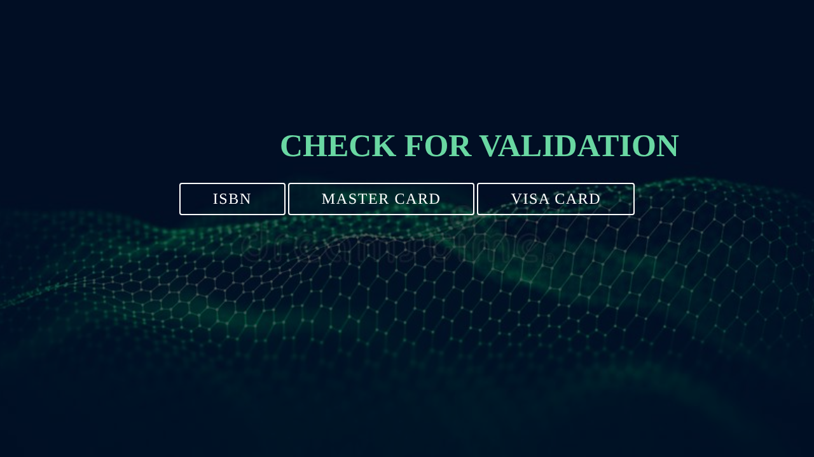
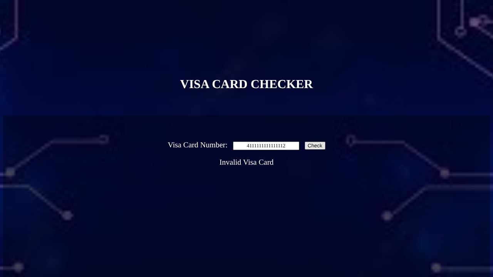
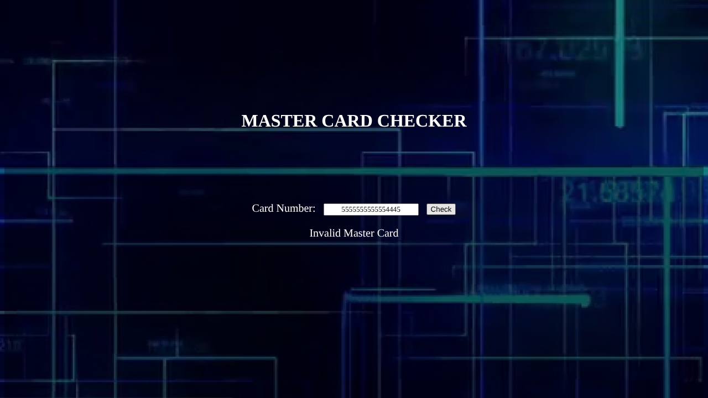
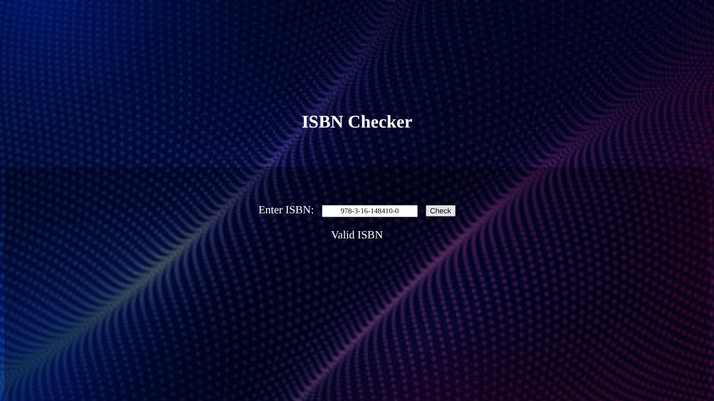
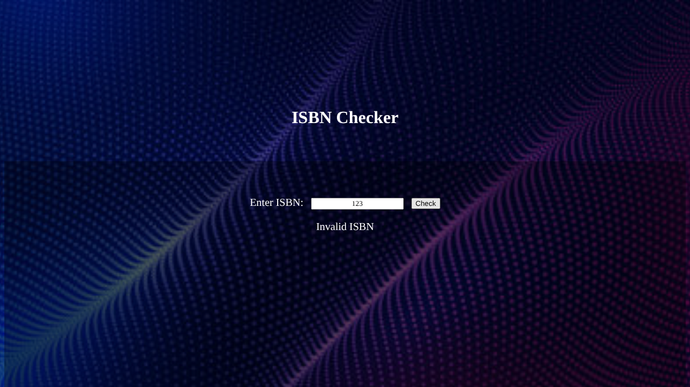

# 💳 Card Validation System

A lightweight, dependency-free web app that checks whether **Visa card numbers**, **Mastercard numbers**, and **ISBNs** are valid — built with plain HTML, CSS, and JavaScript, and runnable by simply opening a file in your browser.



---

## ✨ Features

- **Three validators in one app** – Visa, Mastercard, and ISBN (10 & 13).
- **Luhn algorithm** – card numbers are checked with the industry-standard Luhn checksum.
- **Card-type check** – each card page verifies the number starts with the right digit before running the checksum, so a Mastercard number is rejected on the Visa page and vice versa.
- **Clear feedback** – instant result messages: *Valid Visa Card*, *Invalid Master Card*, *Invalid Card Type*, etc.
- **No build step, no dependencies** – just static files.
- **Themed UI** – full-screen background images and a clean, centered layout on every page.

---

## 📸 Screenshots

### Visa checker
| Valid | Invalid |
|---|---|
|  |  |

### Mastercard checker
| Valid | Invalid |
|---|---|
|  |  |

### ISBN checker
| Valid | Invalid |
|---|---|
|  |  |

---

## 🚀 Getting Started

No installation required.

```bash
# 1. Clone the repository
git clone https://github.com/<your-username>/Card-Validation-System.git

# 2. Open the app
cd "Card-Validation-System/DS project/ttt"
# then double-click main.html, or open it from your browser
```

Optionally, serve it locally:

```bash
python3 -m http.server 8000
# visit http://localhost:8000/main.html
```

> 🌐 The Comfortaa font loads from Google Fonts, so an internet connection is needed to see it. Offline, the browser falls back to a default font.

---

## 🧪 Try It Out

Use these well-known **test numbers** (they are not real cards):

| Validator | Input | Expected result |
|---|---|---|
| Visa | `4111111111111111` | ✅ Valid Visa Card |
| Visa | `4111111111111112` | ❌ Invalid Visa Card (fails Luhn) |
| Visa | `5555555555554444` | ❌ Invalid Card Type: Not a Visa card |
| Mastercard | `5555555555554444` | ✅ Valid Master Card |
| Mastercard | `5555555555554445` | ❌ Invalid Master Card (fails Luhn) |
| ISBN | `978-3-16-148410-0` | ✅ Valid ISBN |
| ISBN | `123` | ❌ Invalid ISBN |

---

## 🧠 How It Works

### Luhn algorithm (Visa & Mastercard)
1. Starting from the **rightmost** digit, move left.
2. **Double every second digit**; if the result is greater than 9, subtract 9.
3. **Sum** all the digits.
4. If the total is divisible by 10, the number passes.

Before the checksum, the first digit is checked: Visa must start with `4`, Mastercard with `5`.

### ISBN
The ISBN page validates the **format** of ISBN-10 and ISBN-13 values (including optional hyphens/spaces and an `ISBN`/`ISBN-10`/`ISBN-13` prefix) using a regular expression.

---

## 📁 Project Structure

```
Card-Validation-System/
├── README.md
├── docs/
│   └── screenshots/        # images used in this README
└── DS project/
    └── ttt/
        ├── main.html       # landing page with navigation buttons
        ├── main.css
        ├── visa.html       # Visa validator (HTML + JS)
        ├── visa.css
        ├── master.html     # Mastercard validator (HTML + JS)
        ├── master.css
        ├── isbn1.html      # ISBN validator (HTML + JS)
        ├── isbn.css
        └── images/         # background images
```

---

## 🛠️ Built With

- **HTML5** – page structure
- **CSS3** – layout, backgrounds, styling
- **JavaScript (vanilla)** – validation logic

---

## ⚠️ Known Limitations & Ideas for Improvement

This is a learning project, and there are some clear next steps:

- **Mastercard range** – only numbers starting with `5` are accepted; the newer `2221–2720` range is rejected.
- **ISBN checksum** – the ISBN check is format-only; it doesn't verify the check digit (e.g. `9783161484101` is reported valid).
- **Input cleanup** – spaces/dashes in card numbers aren't stripped, and empty or non-numeric input isn't handled with a dedicated message.
- **Length check** – card length (13/16/19 for Visa, 16 for Mastercard) isn't enforced.
- **Real-time validation & logo display** – validating as the user types and showing the card logo would be a nice upgrade.
- **Single page** – merging the three pages into one with auto card-type detection (Visa, Mastercard, Amex, …).
- **Code reuse** – move the shared Luhn function into one `.js` file instead of duplicating it.

Contributions and suggestions are welcome!

---

## 🔒 Disclaimer

This tool performs **mathematical validation only**. It does **not** verify that a card exists, is active, or has funds, and nothing you type is sent anywhere — all checks run locally in your browser. Never enter real card details into demo projects.

---

## 📄 License

Add a license of your choice (e.g. [MIT](https://choosealicense.com/licenses/mit/)).
